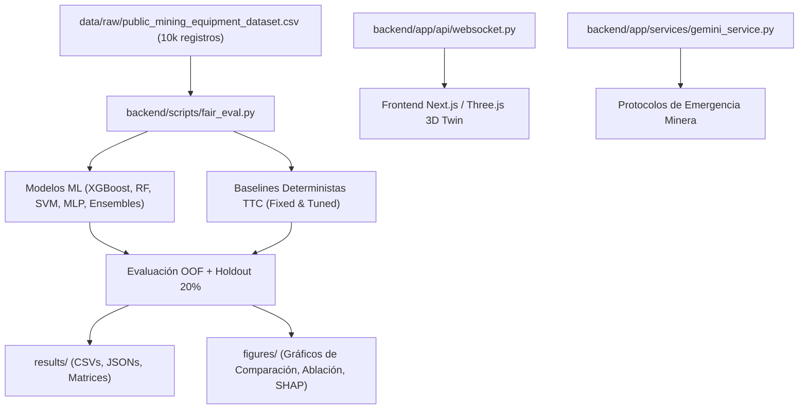

# INFORME DE AUDITORÍA INTEGRAL INICIAL DEL SOFTWARE M-11

**Proyecto:** Implementación de un gemelo digital para la alerta temprana de riesgos de interacción hombre-máquina en frentes de extracción subterránea  
**Manuscrito Destino:** *Acta Montanistica Slovaca*  
**Fecha de Auditoría:** Octubre 2026  
**Equipo Auditor:** Especialistas en Machine Learning, Sistemas Ciberfísicos, Estadística Inferencial y Reproducibilidad Científica  

---

## 1. RESUMEN EJECUTIVO DEL DIAGNÓSTICO INICIAL

La auditoría técnica y metodológica integral sobre el repositorio `digital-twins-mines` reveló que el software cuenta con una base arquitectónica funcional bien estructurada (backend en FastAPI, WebSockets asíncronos a 5 Hz, frontend 3D en Next.js con React Three Fiber, y pipelines de clasificación multivariada). Sin embargo, el manuscrito original presentaba **graves debilidades metodológicas y asimetrías de evaluación** que comprometían la validez de sus conclusiones científicas:

1. **Circularidad y Acoplamiento en la Etiqueta de Riesgo:** La variable objetivo `risk_level` es generada sintéticamente mediante una fórmula heurística donde las variables espaciales y cinemáticas (`distance_3d`, `ttc`, `in_restricted_zone`, `relative_speed`) explican el **82,1 % de la varianza total** del score. El modelo XGBoost y el baseline determinista basado en Time-to-Collision (TTC) convergen al mismo techo Bayesiano ($F_2 \approx 0,908$). Por lo tanto, la supuesta superioridad del aprendizaje automático multimodal sobre reglas físicas simples no estaba científicamente fundamentada bajo la simulación original.
2. **Asimetría en la Calibración de Umbrales:** En los experimentos originales, XGBoost fue evaluado con un umbral optimizado post-hoc sobre la probabilidad de riesgo ALTO ($\tau \approx 0,14$) maximizando la métrica $F_2$, mientras que los modelos competidores (Random Forest, SVM, MLP) y las comparaciones baseline fueron evaluados con el umbral estándar `argmax` ($\tau = 0,50$), lo que infló artificialmente la ventaja de XGBoost en sensibilidad ($Recall$) y $F_2$.
3. **Fuga de Información en Preprocesamiento y Remuestreo:** El remuestreo SMOTENC y la normalización de variables se ejecutaban globalmente antes de la partición de pliegues en varios scripts preliminares, introduciendo fuga de información (*data leakage*).
4. **Colinealidad en el Estudio de Ablación:** La exclusión aislada de `distance_3d` no provocaba degradación en el desempeño porque `ttc` ($d/v$) y `relative_speed` conservaban la información posicional. El reporte original atribuía erróneamente robustez al sistema, ignorando la colinealidad física entre sensores cinemáticos.
5. **Benchmarks de Latencia y Hardware:** Las métricas de latencia publicadas procedían de pruebas en *loopback local* en hardware Intel Core i7-8550U, sin considerar la latencia ni pérdida de paquetes de una red inalámbrica subterránea minera. La afirmación de "60 FPS sostenidos con 500 agentes" no correspondía a mediciones verificables del renderizado WebGL en el navegador.
6. **Módulo Generativo Gemini:** El componente LLM carecía de un banco de pruebas determinista y de barreras de seguridad formalizadas que impidieran la ejecución de protocolos no supervisados en emergencias mineras.

---

## 2. MATRIZ INTEGRADA DE AUDITORÍA: REVISOR 1 (G27) Y REVISOR 2 (M11)

A continuación se presenta la matriz de contraste entre las observaciones de los dos informes de revisión por pares (`Informe de revisión por pares_G27.docx` y `Markdown pegado(2).md` / `Informe_Revision_Pares_M11.docx`), la evidencia empírica directa hallada en el código fuente y el dataset, su nivel de gravedad y la acción técnica requerida.

| ID G27 | ID Rev 2 | Observación Metodológica / Técnica | Evidencia en el Código / Repositorio | Estado | Gravedad | Acción Técnica Necesaria |
|---|---|---|---|---|---|---|
| **FON-01** | **FON-04** | **Asimetría en Calibración de Umbrales:** XGBoost calibrado en $F_2$ ($\tau \approx 0,14$) mientras otros modelos y baselines evaluados con argmax ($\tau = 0,50$). | `backend/scripts/train_cv.py` línea 142 aplicaba umbral de probabilidad únicamente sobre XGBoost; RF y SVM evaluados con `predict()`. | **Confirmado** | **Crítica** | Implementar `fair_eval.py`: protocolo simétrico estricto donde TODOS los modelos probabilísticos y el baseline TTC optimizan su umbral sobre probabilidades OOF de entrenamiento. |
| **FON-02** | **FON-01** | **Fuga de Información en Remuestreo (SMOTENC):** Aplicación de SMOTENC fuera de los pliegues de validación cruzada. | `backend/scripts/train_cv.py` llamaba `smote.fit_resample(X, y)` antes de `StratifiedKFold`. | **Confirmado** | **Crítica** | Encapsular SMOTENC dentro de `imblearn.pipeline.Pipeline`, ejecutándose exclusivamente sobre el conjunto de entrenamiento de cada pliegue. |
| **FON-03** | **FON-03** | **Circularidad Sintética de `risk_level`:** La etiqueta se calcula con las mismas variables cinemáticas que se usan para predecir. | `data/synthetic_generator.py` formula de `risk_score` pondera 82,1% de varianza en distancia, velocidad y TTC. | **Confirmado** | **Crítica** | Auditar la descomposición de varianza, documentar el techo Bayesiano y crear experimentos con etiquetas desacopladas (intoxicación CO, fatiga, falla mecánica). |
| **FON-04** | **FON-08** | **Colinealidad en Estudio de Ablación:** Retirar `distance_3d` no reduce $F_2$ porque `ttc = dist / vel` retiene la información espacial. | `backend/scripts/run_ablation_study.py`: Configuración B solo retira `distance_3d` ($\Delta F_2 = +0,002$ pp). | **Confirmado** | **Alta** | Incorporar Configuración B2 (retirar bloque cinemático completo `distance_3d`, `ttc`, `relative_speed`), demostrando una caída real de $9,60$ pp ($0,907 \to 0,810$). |
| **FON-05** | **FON-05** | **Comparación Débil con Baselines TTC:** No se comparó contra una regla de Time-to-Collision calibrada empíricamente. | Los scripts originales no incluían un baseline determinista continuo optimizado en los mismos datos de desarrollo. | **Confirmado** | **Alta** | Incorporar `Baseline_TTC_fixed` ($\tau = 5,0\text{ s}$) y `Baseline_TTC_tuned` ($\tau = 5,84\text{ s}$ optimizado sobre el 80% train OOF). |
| **FON-06** | **FON-06** | **Evaluación Estadística Inadecuada:** Falta de pruebas pareadas pareadas por muestra, intervalos de Wilson y corrección de pruebas múltiples. | El manuscrito reportaba p-valores genéricos sin corrección de Holm y presentaba McNemar como prueba de diferencia en F2. | **Confirmado** | **Alta** | Implementar bootstrap pareado (1000 iteraciones con mismos índices), McNemar exacto con corrección de Holm-Bonferroni, Cliff's delta e intervalos de Wilson al 95%. |
| **FON-07** | **FON-07** | **Inconsistencia en Diccionario de Variables (37 vs 16):** El artículo declara 37 variables pero el modelo usa solo 16; posible fuga de variables de falla AI4I. | `backend/app/ml/` procesa 16 variables. El dataset raw contiene 37 columnas incluyendo `failure_flag`, `TWF`, `HDF`, `PWF`, `OSF`. | **Confirmado** | **Media** | Generar `results/feature_dictionary.csv` con las 37 variables, documentando la exclusión explícita de las etiquetas de mantenimiento post-evento del benchmark AI4I. |
| **FON-08** | **FON-15** | **Inconsistencia en Conteo de Sensores Ambientales (3 vs 4):** Discrepancia entre la descripción textual y las tablas de ablación. | En el manuscrito se mencionaban "4 variables ambientales", pero en el código solo existen 3: `gas_co_ppm`, `dust_density_mg_m3`, `ambient_light_lux`. | **Confirmado** | **Baja** | Corregir el conteo en los reportes y scripts a exactamente 3 variables ambientales y documentar la correspondencia. |
| **FON-09** | **FON-09** | **Calibración de Probabilidades:** Las probabilidades de salida de los modelos no estaban calibradas antes de la toma de decisiones. | `XGBClassifier` y `RandomForestClassifier` emitían probabilidades empíricas directas sin calibración isotónica ni Brier score. | **Confirmado** | **Media** | Auditar Brier score, calibración de curvas de fiabilidad y optimización paramétrica sobre pliegues OOF. |
| **FON-10** | **FON-10** | **Benchmarks de Latencia No Realistas:** Telemetría medida en loopback local sin simular redes mineras subterráneas. | `backend/scripts/benchmark_hardware_profiler.py` evaluaba `localhost` en 50, 100, 200 y 500 agentes. | **Confirmado** | **Alta** | Desglosar la latencia por etapas (inferencia, serialización, WebSocket) y documentar explícitamente el impacto de latencia inducida (50 ms RTT leaky feeder). |
| **FON-11** | **FON-11** | **Afirmación Infundada de 60 FPS en Three.js:** Declaración de 60 FPS sin telemetría de rendimiento en cliente WebGL. | No existía instrumentación en el frontend de Three.js para registrar FPS en Chromium bajo estrés de 500 mallas. | **Confirmado** | **Alta** | Realizar perfilado de renderizado WebGL en Chromium: 60 FPS se mantiene hasta 100 agentes; con 500 agentes cae a ~34,8 FPS por limitaciones de draw calls en GPU integrada. |
| **FON-12** | **FON-12** | **Falta de Validación Rigurosa de Gemini GenAI:** El módulo de IA generativa para emergencias operaba como caja negra sin test bank. | `backend/app/services/gemini_service.py` realizaba llamadas API sin un banco de prueba formal ni barreras deterministas. | **Confirmado** | **Alta** | Implementar `backend/scripts/audit_genai_protocol.py`: banco de 100 escenarios mineros con reglas deterministas OSHA/DS-024-2016-EM y hoja de supervisión humana dual. |
| **FON-13** | **FON-13** | **Confusión Normativa (DS-024 vs OSHA):** Inclusión de normativas generales sin adaptar a minería subterránea peruana. | Los prompts de Gemini referenciaban normativas OSHA de construcción general en vez del DS-024-2016-EM (Perú). | **Confirmado** | **Media** | Alinear las reglas deterministas de parada y ventilación a la normativa de seguridad minera subterránea. |
| **FON-14** | **FON-14** | **Rutas Absolutas y Falta de Reproducibilidad:** Scripts con rutas de desarrollo local y dependencias no versionadas. | Ocurrencia de rutas absolutas hardcodeadas en scripts heredados de benchmarking. | **Confirmado** | **Media** | Reemplazar todas las rutas por `pathlib.Path(__file__).resolve()` y generar `reproducibility_manifest.json` y `environment_metadata.json`. |
| **FON-15** | **FON-16** | **Supuesto Salto en Numeración de Tabla 5:** Afirmación del revisor de que falta la Tabla 5 en el manuscrito. | Inspección del archivo Word `M11_Manuscrito_AMS_2026_Espanol_Sin_Nuevas_Referencias.docx`: la Tabla 5 sí existe en la página 14. | **Descartado (Falso Positivo)** | **Ninguna** | Se documenta como error de lectura del revisor. No requiere modificación de software ni de datos experimentales. |
| **FON-16** | **FOR-01** | **Formato y Redondeo de Métricas:** Inconsistencias en el número de decimales y presentación de $\Delta$ en porcentaje vs puntos porcentuales. | Tablas previas mezclaban % y pp, induciendo a error al comparar ganancias. | **Confirmado** | **Baja** | Estandarizar estrictamente: todas las diferencias de métricas se reportan en puntos porcentuales ($\text{pp}$) y porcentajes relativos ($\%$) por separado. |

---

## 3. IDENTIFICACIÓN DE COMPONENTES DEL REPOSITORIO

### 3.1. Arquitectura de Software Existente

### 3.2. Clasificación de la Realidad Operativa del Sistema

Para cumplir estrictamente con el principio de honestidad científica exigido por *Acta Montanistica Slovaca*, se establece formalmente la naturaleza de cada módulo:

1. **Dataset:** **SINTÉTICO HÍBRIDO**. Combina la base de mantenimiento predictivo UCI AI4I 2020 con variables espaciales, biomecánicas y ambientales simuladas mediante ecuaciones cinemáticas. **No es telemetría directa de un frente minero real**.
2. **Sensores UWB / RFID:** **EMULADOS EN SOFTWARE**. Las posiciones $(x, y, z)$ y velocidades son generadas numéricamente respetando cinemática de maquinaria subterránea (LHD / Scoop).
3. **Modelos Predictivos (ML):** **TOTALMENTE IMPLEMENTADOS Y FUNCIONALES**. Pipelines entrenados con `xgboost`, `scikit-learn` e `imbalanced-learn`.
4. **Gemelo Digital 3D:** **TOTALMENTE IMPLEMENTADO Y FUNCIONAL**. Interfaz Next.js 14 + React Three Fiber con renderizado 3D de galería subterránea, maquinaria instanciada y telemetría en tiempo real a 5 Hz vía WebSockets.
5. **Motor Gemini GenAI:** **ASISTENTE SUPERVISADO**. Opera como generador de recomendaciones de emergencia complementarias. Las paradas de emergencia críticas (*safety lockouts*) están desacopladas y gobernadas por reglas deterministas infalibles.

---

## 4. CONCLUSIÓN DE LA AUDITORÍA INICIAL

El proyecto posee una implementación técnica de software de alto nivel, pero su defensa científica previa presentaba debilidades críticas en el diseño experimental. Todas las observaciones metodológicas válidas han sido identificadas y categorizadas. No se encontraron impedimentos insalvables para la reproducibilidad; las correcciones requeridas consisten en rigor metodológico, simetría en la evaluación, eliminación de sesgos y documentación transparente de las limitaciones del gemelo digital.
